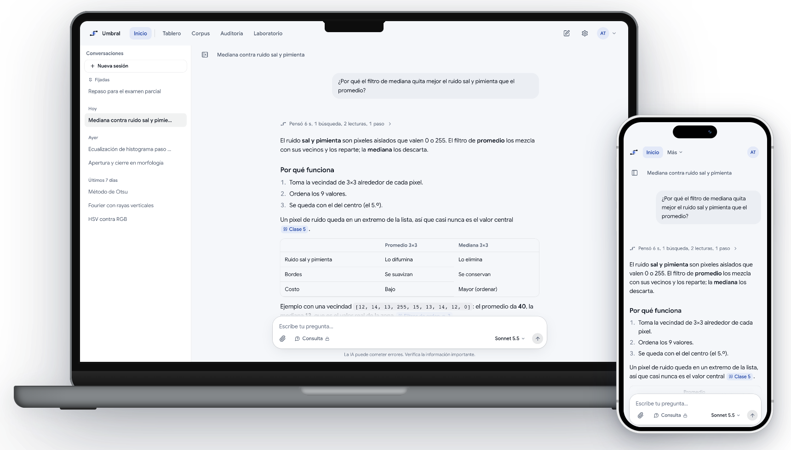
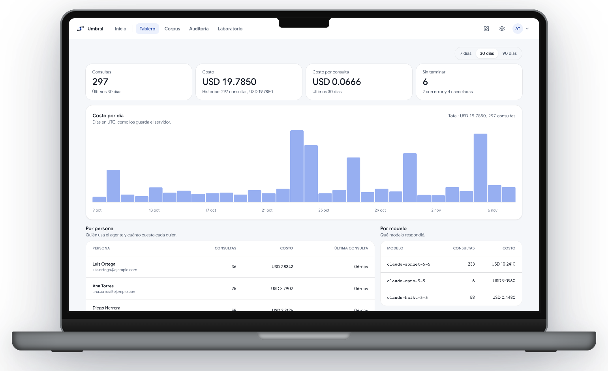
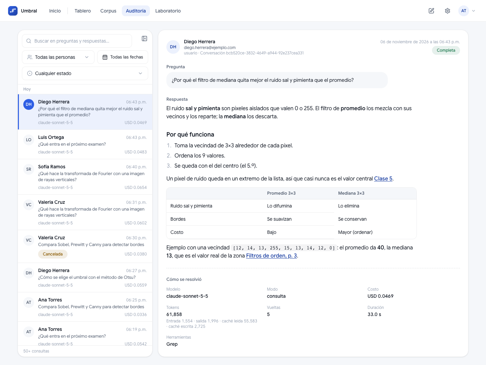
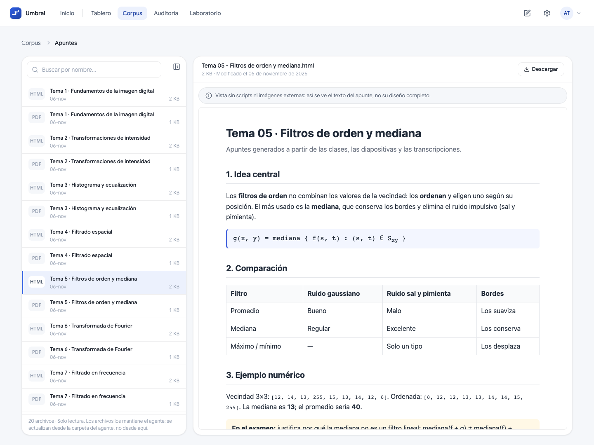
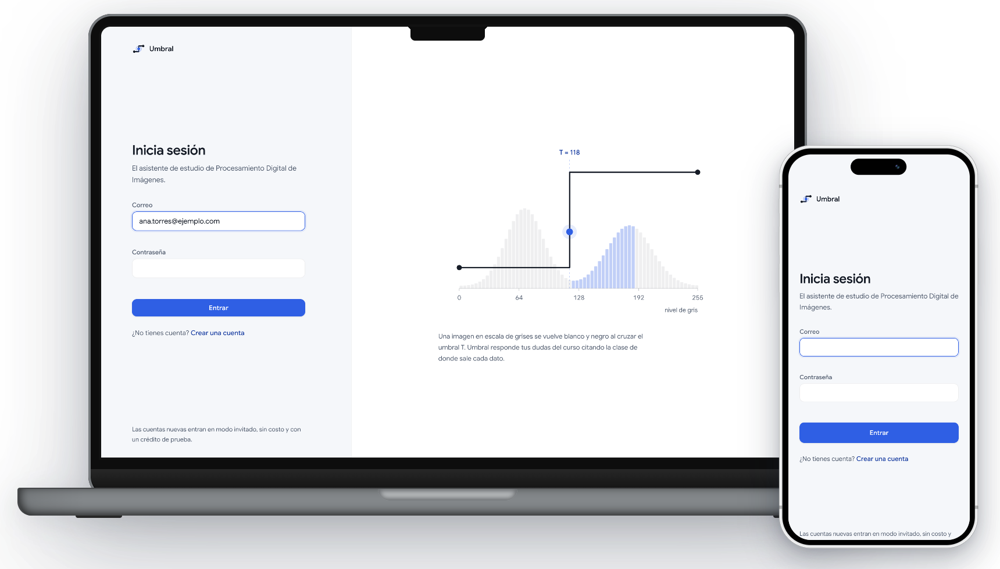
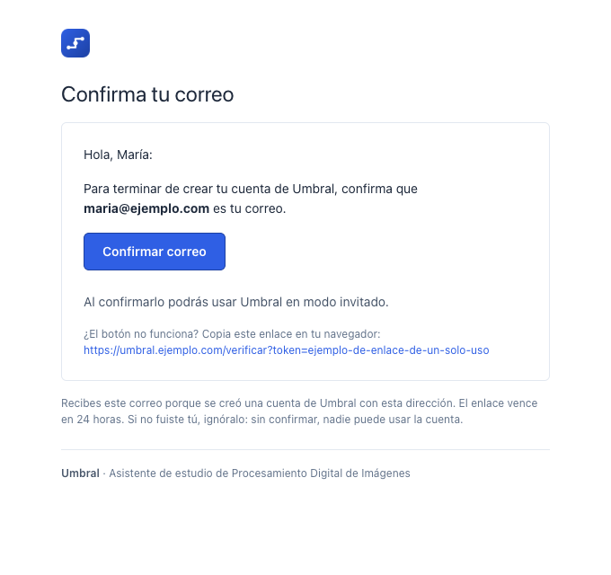
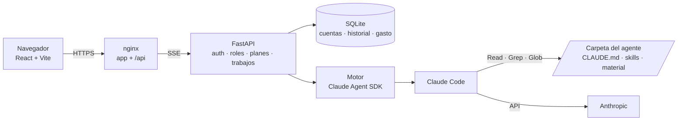

<div align="center">


# Umbral

**Lleva un agente de Claude de tu laptop a la web.**

Chat multiusuario con tareas que sobreviven a cerrar la página, gasto en vivo, registro con verificación por correo y despliegue con un solo `docker compose up`.

<p>
  <a href="https://github.com/JoseLuis0022/umbral/actions/workflows/pruebas.yml"></a>
  <a href="LICENSE"></a>
  
  
  
  
</p>

<p><a href="#un-vistazo">Un vistazo</a> &nbsp;|&nbsp; <a href="#qué-hace">Qué hace</a> &nbsp;|&nbsp; <a href="#arquitectura">Arquitectura</a> &nbsp;|&nbsp; <a href="#despliegue-con-docker-compose">Despliegue</a> &nbsp;|&nbsp; <a href="#desarrollo-local">Desarrollo</a></p>

<br><br>



<sub>El agente responde con citas clicables a la clase y a la página exacta de las diapositivas, y manda el apunte del tema. En escritorio y en el celular, instalable como app.</sub>

</div>

---

## Por qué existe

Un agente de Claude Code que funciona en tu computadora (un `CLAUDE.md`, unas
skills y una carpeta de material) está a un paso de ser útil para otros, pero
ese paso es grande: usuarios, permisos, costos, tareas largas que no pueden
depender de una pestaña abierta, y un servidor. Umbral es esa capa: toma la
carpeta del agente tal cual y la sirve como una aplicación web.

El primer agente que corre en Umbral es un asistente de estudio de
**Procesamiento Digital de Imágenes**.

## Tecnologías

| Capa | Tecnologías |
|---|---|
| **Agente** |    |
| **Backend** |      |
| **Frontend** |      |
| **Infraestructura** |    |

## Un vistazo

<table>
  <tr>
    <td width="50%" valign="top">
      
      <p align="center"><b>Tablero</b><br><sub>Consultas y costo por día, por persona y por modelo, con el gasto en vivo.</sub></p>
    </td>
    <td width="50%" valign="top">
      
      <p align="center"><b>Auditoría</b><br><sub>Cada pregunta y respuesta, con modelo, tokens, herramientas y lo que costó.</sub></p>
    </td>
  </tr>
  <tr>
    <td width="50%" valign="top">
      
      <p align="center"><b>Corpus</b><br><sub>El material del agente por colecciones: lo que el estudiante puede recibir y lo que solo el agente lee.</sub></p>
    </td>
    <td width="50%" valign="top">
      
      <p align="center"><b>Acceso</b><br><sub>La función umbral a escala real: reacciona a lo que escribes y, al entrar, el nodo cruza el umbral.</sub></p>
    </td>
  </tr>
</table>

<details>
<summary><b>Correo de verificación</b> (registro self-service)</summary>
<br>
<p align="center"></p>
</details>

<sub>Las capturas usan una instancia de demostración (cuentas y material ficticios). Marcos de dispositivo con <a href="https://github.com/picturepan2/devices.css">devices.css</a> (MIT).</sub>

## Qué hace

**Para quien usa el chat**
- Respuestas en streaming con el proceso del agente a la vista (qué está leyendo, buscando o generando).
- **Tareas en segundo plano**: la consulta vive en el servidor; cambiar de pantalla, recargar o cerrar la pestaña no la cancela. Al volver, la respuesta está ahí (y suena un aviso si tardó).
- **Cola de mensajes**: se puede seguir escribiendo mientras el agente trabaja; lo encolado sale junto al terminar.
- **Citas de fuentes clicables**: el agente enlaza la clase, la página del PDF o el apunte de donde sale cada dato, con la frase resaltada.
- Adjuntos de cualquier tipo (imágenes, PDF, texto, video como fotogramas) y archivos del curso que el agente puede mandar.
- Historial sincronizado entre dispositivos; conversaciones fijadas, archivadas y no leídas.
- **PWA instalable** (escritorio y celular) con animación de arranque; el service worker nunca sirve una versión vieja.

**Para quien opera la plataforma**
- **Registro self-service** con verificación por correo (Gmail + contraseña de aplicación, configurable desde la app).
- **Modo invitado**: cuentas nuevas con un modelo económico y un crédito de prueba por cuenta, más un **tope mensual global** para todos los invitados.
- **Gasto en vivo**: cada consulta se registra al empezar y su costo se actualiza mientras corre (estimado calibrado contra el costo real que reporta el agente).
- **Resiliencia**: reintentos visibles (API, agente y red), "Continuar donde se quedó" tras un fallo, y tareas exclusivas que hacen fila en vez de fallar.
- Panel de administración: tablero de costos, auditoría de cada consulta, explorador del corpus y laboratorio para probar modelos y prompts.

## En producción

Umbral corre en [umbral.imperioon.com](https://umbral.imperioon.com) desde el 4
de noviembre de 2026. Cifras del registro de consultas al 13 de noviembre: 99
consultas reales al agente (82 en Consulta, 17 en Generador), la mayoría del
autor probando y midiendo, por US$19.24 en total.

| Modo Consulta, por modelo | Costo por pregunta (mediana) | Tiempo por respuesta (mediana) |
|---|---|---|
| Opus 5.5 | US$0.114 | 6.5 s |
| **Sonnet 5.5** | **US$0.033** | **8.0 s** |
| Haiku 5.5 (invitados) | US$0.0035 | 11.2 s |

Por esa comparación el modo Consulta usa **Sonnet**: cuesta 3.4 veces menos que
Opus por pregunta con tiempos parecidos. Las cuentas de invitado usan Haiku.

## Arquitectura



| Capa | Dónde | Responsabilidad |
|---|---|---|
| Interfaz | `frontend/` | Chat y administración. Muestra; no decide nada de seguridad. |
| Puerta | `backend/app/rutas_*.py`, `seguridad.py`, `planes.py` | Quién eres (JWT), qué rol tienes, qué modo puedes usar, cuánto crédito te queda. |
| Trabajos | `backend/app/trabajos.py` | Cada consulta es una tarea propia; la respuesta HTTP solo la **observa**. |
| Motor | `backend/app/motor.py` | Corre el agente, traduce sus mensajes al protocolo SSE y estima el costo en vivo. |
| Agente | carpeta montada en `/agente` | El agente tal cual existe en la laptop. No forma parte de este repositorio. |

Los **modos** del agente son datos, no código (`backend/app/perfiles.py`):

| Modo | Herramientas | Quién |
|---|---|---|
| Consulta | Read, Grep, Glob (confinadas a la carpeta del agente) | invitado, usuario, especialista, admin |
| Generador | + Bash, Write, Edit, Skills | especialista, admin |

## Decisiones de diseño

- **Modos como datos, no como código.** Un modo del agente (prompt, herramientas, modelo, presupuesto, carpetas vedadas) es una entrada en `perfiles.py`, y un rol es la lista de modos que puede usar. Agregar un modo no toca ningún `if`; la puerta solo pregunta "¿este rol incluye este modo?" y el motor solo recibe un perfil.
- **La consulta vive separada de la conexión.** `POST /api/chat` crea un trabajo en el servidor y la respuesta HTTP solo lo observa. Cerrar la pestaña no cancela nada; reconectar repite los eventos desde el principio; detener es una acción explícita.
- **Defensa en capas.** La identidad sale del token y el rol de la base en cada petición. El modo Consulta no tiene Bash ni escritura, sus herramientas pasan por reglas de permiso y además por un hook que revisa cada llamada (rutas absolutas, `..`, patrones). El gasto se corta en el servidor: tope por consulta, crédito por cuenta y tope mensual global; la interfaz solo lo muestra.
- **Búsqueda agéntica en lugar de RAG.** El agente busca en su carpeta con Grep y Read, como en la laptop: sin índice que mantener ni fragmentos que se desactualicen. La comparación contra un RAG bien armado está en curso (ver la hoja de ruta).
- **El mismo protocolo para el motor real y el de prueba.** `MOTOR=prueba` emite los mismos eventos SSE sin llamar a Claude: sirve para la interfaz y para las pruebas automáticas, que corren sin API key ni costo.

## Despliegue con Docker Compose

Requisitos: un servidor Linux con Docker y Docker Compose v2.

```bash
git clone https://github.com/JoseLuis0022/umbral.git && cd umbral

# 1. Configuración
cp .env.example .env
#    ANTHROPIC_API_KEY=…   (console.anthropic.com)
#    JWT_SECRETO=…         python3 -c "import secrets; print(secrets.token_urlsafe(48))"

# 2. El agente: su carpeta va en ./agente (o en AGENTE_DIR)
#    y debe pertenecer al UID 1000, que es con el que corre el backend.
sudo chown -R 1000:1000 agente

# 3. Levantar
docker compose up -d

# 4. Tu cuenta de administrador
docker compose exec backend python -m app.cli_usuarios crear \
  --correo tu@correo.com --nombre "Tu Nombre" --rol admin
```

Umbral queda en `http://servidor:8080` (cambia el puerto con `PUERTO`). Pon
HTTPS delante: Cloudflare Tunnel, Caddy o el proxy que ya uses.

Después, desde la app: **Ajustes → Registro público → Configurar correo**
(Gmail y contraseña de aplicación) para abrir el registro.

| Tarea | Comando |
|---|---|
| Actualizar | `git pull && docker compose up -d --build` |
| Ver registros | `docker compose logs -f backend` |
| Respaldar datos | Automático cada día (servicio `respaldo`); uno ya: `docker compose exec respaldo python -m app.respaldo --ahora` |
| Cuentas | `docker compose exec backend python -m app.cli_usuarios listar` |

### Respaldos

El servicio `respaldo` de Docker Compose copia la base cada día (10:00 UTC) al
volumen `respaldos` con la API de backup de SQLite, que da una copia consistente
aunque el backend esté escribiendo. Revisa la integridad de cada copia y
conserva las últimas 14 (`HORA_RESPALDO`, `CONSERVAR_RESPALDOS`). No necesita
cron del servidor.

```bash
docker compose exec respaldo python -m app.respaldo --ahora   # uno ya
docker compose cp respaldo:/respaldos ./respaldos              # sacarlos del servidor
```

El volumen vive en el mismo disco: para un respaldo a prueba de que muera el
servidor, copia esa carpeta a otro disco o a un almacenamiento externo.

> **Un solo proceso.** Las tareas en curso viven en la memoria del backend; por
> eso no se escala con varios workers. Al desplegar, el contenedor espera hasta
> 45 s a que terminen las respuestas en curso.

### Variables (`.env`)

| Variable | Obligatoria | Para qué |
|---|---|---|
| `ANTHROPIC_API_KEY` | sí | La cuenta de Anthropic que paga las consultas. Pon también un tope de gasto en la consola. |
| `JWT_SECRETO` | sí | Firma de las sesiones (≥ 32 caracteres). |
| `PUERTO` | no | Puerto publicado (8080). |
| `ENLACE` | no | Interfaz donde se publica el puerto (`0.0.0.0`). Detrás de un túnel de Cloudflare en el mismo servidor: `127.0.0.1`. |
| `CONFIAR_CLOUDFLARE` | no | Usar `CF-Connecting-IP` para los límites por IP (`false`). Solo con `ENLACE=127.0.0.1` y túnel: si nginx es alcanzable directo, ese encabezado se puede inventar. |
| `DOCS_API` | no | Publicar la documentación interactiva en `/api/docs` (`false`). |
| `AGENTE_DIR` | no | Carpeta del agente en el servidor (`./agente`). |
| `AGENTES_SIMULTANEOS` | no | Consultas a la vez; las demás esperan turno (3). |
| `JWT_HORAS` | no | Duración de la sesión (12). |
| `MOTOR` | no | `sdk` (real) o `prueba` (respuestas fijas, sin gastar). |
| `VITE_BASE_URL` | no | Subcarpeta del dominio, si la hay (`/`). |
| `VITE_URL_PUBLICA` | no | Dirección pública (`https://…`), para la vista previa al compartir el enlace. |
| `CARPETA_CLASES` · `CARPETA_TRANSCRIPCIONES` | no | Dónde están las diapositivas y las transcripciones dentro de la carpeta del agente (`Clases`, `Clases/Transcripciones`). |
| `CARPETAS_PRIVADAS` | no | Carpetas que el modo Consulta nunca lee, separadas por coma (`Prácticas`). |

### Adaptarlo a tu curso

El prompt del modo Consulta que trae el repo es genérico. Para darle el nombre
de tu materia y sus reglas (qué se puede resolver, qué no), crea
`.umbral/prompts/consulta.md` dentro de la carpeta del agente: gana sobre el
genérico, vive con tu material y no se publica con el código. El modo Consulta
no puede leer esa carpeta.

## Desarrollo local

```bash
# Backend (Python 3.13)
cd backend
uv venv --python 3.13 .venv
uv pip install --python .venv/bin/python -r pyproject.toml
cp .env.example .env                     # JWT_SECRETO; ANTHROPIC_API_KEY si MOTOR=sdk
.venv/bin/python -m app.cli_usuarios crear --correo tu@correo.com --nombre "Tu Nombre" --rol admin
.venv/bin/uvicorn app.main:app --reload --port 8000

# Frontend (Node ≥ 22)
cd frontend && npm ci && npm run dev     # http://localhost:5173
```

`MOTOR=prueba` responde sin llamar a Claude y habla el mismo protocolo: sirve
para trabajar la interfaz sin gastar. Con `DOCS_API=true`, la API documentada
está en `http://localhost:8000/api/docs`.

### Pruebas

```bash
cd backend
uv pip install --python .venv/bin/python -e ".[dev]"
.venv/bin/python -m pytest          # base temporal + MOTOR=prueba: sin API key ni costo
cd ../frontend && npm run typecheck && npm run build
```

Cubren las guardias de rutas (que el modo Consulta no salga de su carpeta ni
lea las privadas), los tokens (`alg: none`, vencidos, otra firma, rol leído de
la base), el login y el registro (bloqueo tras 5 fallos, código y enlace de
verificación, límite por IP sin confiar en encabezados inventados), los topes
de gasto de invitados y un chat completo por SSE. GitHub Actions corre todo en
cada push.

## Seguridad

- **La identidad sale del token, nunca del cuerpo**; el rol se lee de la base en cada petición.
- **El modo Consulta no puede leer fuera de la carpeta del agente**: un hook revisa cada llamada a herramienta (rutas absolutas, `../`, patrones de búsqueda).
- Las cuentas del registro **no entran sin verificar** el correo, con enlace o con un código de 6 dígitos; los dos se guardan como hash y el código admite 5 intentos. Límite de cuentas por IP y correos desechables rechazados.
- **La IP del cliente no se toma de un encabezado que cualquiera pueda inventar**: `CF-Connecting-IP` solo cuenta con `CONFIAR_CLOUDFLARE=true`, que exige que nginx solo sea alcanzable por el túnel.
- **Límite de intentos en el inicio de sesión**: tras 5 fallos contra una cuenta (o 20 desde una red) se bloquea 15 minutos.
- La contraseña de aplicación de Gmail se guarda **cifrada** y nunca sale de la API.
- Cada consulta tiene un tope de gasto que corta el propio agente; los invitados, además, su crédito y el tope mensual global.
- El backend corre sin root y solo es accesible a través de nginx. `/api/docs` está apagado en producción y `/api/salud` no revela la configuración.

## Estructura

```
umbral/
├── backend/
│   ├── app/
│   │   ├── main.py              arranque, rutas
│   │   ├── motor.py             el agente: SDK → protocolo SSE, reintentos, costo en vivo
│   │   ├── trabajos.py          consultas como tareas que sobreviven a la conexión
│   │   ├── rutas_*.py           auth, chat, conversaciones, admin, configuración
│   │   ├── perfiles.py          modos del agente y roles (datos, no código)
│   │   ├── planes.py            crédito del invitado y tope mensual
│   │   ├── precios.py           estimado de costo que se calibra solo
│   │   ├── correo.py            Gmail + plantillas HTML
│   │   ├── guardias.py          qué rutas puede tocar el agente
│   │   ├── respaldo.py          copia diaria de la base (servicio `respaldo`)
│   │   └── prompts/             system prompt del modo Consulta
│   ├── tests/                   pytest (guardias, tokens, auth, planes, chat SSE)
│   └── Dockerfile
├── frontend/
│   ├── src/                     React: pantallas, contexto del chat, servicios
│   ├── nginx.conf               app + /api (SSE sin búfer)
│   └── Dockerfile
├── .github/workflows/           CI: pytest, typecheck y build en cada push
├── docker-compose.yml
└── .env.example
```

## Hoja de ruta

- **Pruebas de punta a punta**: un recorrido con Playwright (registro → código → chat → respuesta con cita) y pruebas de componentes del frontend, sumadas a la CI que ya corre pytest, typecheck y build.
- **Ejemplos interactivos en el chat**: que el agente pueda generar HTML (simulaciones, gráficas, un filtro aplicado sobre una imagen con controles) y que se renderice dentro de la conversación, como los artefactos de Claude, en un iframe aislado (`sandbox`) para que se pueda explorar sin riesgo.
- Sesión en cookie `httpOnly` en lugar de `localStorage`.
- Recuperación de contraseña.
- Sandbox del sistema operativo para el modo Generador (Bash).
- **Búsqueda agéntica contra RAG**: un banco de 202 preguntas sobre el mismo material, comparando calidad, tiempo y costo de la búsqueda con Grep/Read contra un RAG con embeddings, BM25 y reranker (en curso).
- Observabilidad con OpenTelemetry.

---

<sub>Hecho por José Luis Macedo Escamilla · Licencia [MIT](LICENSE). La fuente Google Sans se distribuye bajo la [SIL Open Font License 1.1](frontend/src/assets/fuentes/OFL.txt).</sub>
